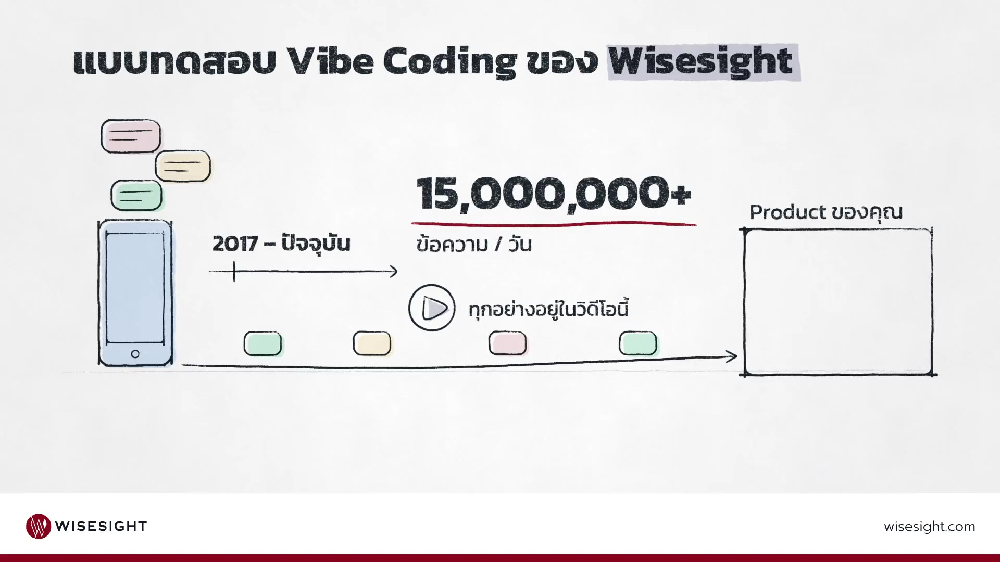

<p align="center">
  <a href="https://wisesight.com">
    <picture>
      <source media="(prefers-color-scheme: dark)" srcset="assets/wisesight-logo-horizontal-white.svg">
      
    </picture>
  </a>
</p>

<h1 align="center">Vibe Coding Test</h1>

<p align="center"><b>Software Engineer</b></p>

<p align="center"><i>Analyze Insights with Ultimate Intelligent Solution</i></p>

<p align="center">
  <a href="#english">English</a> · <a href="#ภาษาไทย">ภาษาไทย</a>
</p>

---

## English

Thank you for taking the Wisesight Vibe Coding Test for Software Engineers. Everything you need is in this repository: a video brief and three example datasets.

### 1 · Watch the brief

The full brief is in the video, and only there. Both versions have the same content; pick one and watch it to the end.

<table>
  <tr>
    <td align="center" width="50%">
      <a href="task-en.mp4"></a>
      <br><b><a href="task-en.mp4">▶ English</a></b> · 5:05
    </td>
    <td align="center" width="50%">
      <a href="task-th.mp4"></a>
      <br><b><a href="task-th.mp4">▶ Thai</a></b> · 5:39
    </td>
  </tr>
</table>

### 2 · Get the example data

Three real exports of Thai social media messages, one topic each, all with the same layout. They're in [`resources/`](resources), stored with [Git LFS](https://git-lfs.com).

> [!IMPORTANT]
> Install Git LFS before you clone, then clone with Git (GitHub's **Download ZIP** may not include LFS files):
>
> ```sh
> git lfs install
> git clone https://github.com/wisesight/vibe-coding-test.git
> ```
>
> Already cloned without it? Run `git lfs pull` inside the repository. Without Git LFS the `.xlsx` files are small text pointers, not spreadsheets.

| File | Topic | Size |
| --- | --- | --- |
| [`resources/fabric-softener-social-messages.xlsx`](resources/fabric-softener-social-messages.xlsx) | Fabric softener | 9.3 MB |
| [`resources/electric-car-social-messages.xlsx`](resources/electric-car-social-messages.xlsx) | Electric cars & trains (รถไฟฟ้า) | 225 MB |
| [`resources/school-social-messages.xlsx`](resources/school-social-messages.xlsx) | Schools | 362 MB |

> [!NOTE]
> The example data contains real public social media posts. Use it only for this test and don't republish it.

### 3 · Submit

Send the link to your GitHub repository to the Wisesight contact who sent you this test, and make sure we can open it. Questions go to the same contact.

### Repository layout

```text
.
├── README.md
├── task-en.mp4            # the brief, English
├── task-th.mp4            # the brief, Thai
├── resources/             # example data (Git LFS)
│   ├── fabric-softener-social-messages.xlsx
│   ├── electric-car-social-messages.xlsx
│   └── school-social-messages.xlsx
└── assets/                # logo and video covers for this page
```

---

## ภาษาไทย

ขอบคุณที่มาทำแบบทดสอบ Vibe Coding สำหรับตำแหน่ง Software Engineer ของ Wisesight ทุกอย่างที่ต้องใช้อยู่ใน Repository นี้แล้ว คือวิดีโอโจทย์และชุดข้อมูลตัวอย่างสามชุด

### 1 · ดูโจทย์

โจทย์ทั้งหมดอยู่ในวิดีโอเท่านั้น ทั้งสองเวอร์ชันมีเนื้อหาเหมือนกัน เลือกภาษาที่ถนัดแล้วดูให้จบ

<table>
  <tr>
    <td align="center" width="50%">
      <a href="task-th.mp4"></a>
      <br><b><a href="task-th.mp4">▶ ภาษาไทย</a></b> · 5:39
    </td>
    <td align="center" width="50%">
      <a href="task-en.mp4"></a>
      <br><b><a href="task-en.mp4">▶ ภาษาอังกฤษ</a></b> · 5:05
    </td>
  </tr>
</table>

### 2 · ดาวน์โหลดข้อมูลตัวอย่าง

ข้อความจริงจากโซเชียลมีเดียไทยสามชุด ชุดละหนึ่งหัวข้อ โครงสร้างเหมือนกันทุกไฟล์ อยู่ในโฟลเดอร์ [`resources/`](resources) และเก็บด้วย [Git LFS](https://git-lfs.com)

> [!IMPORTANT]
> ติดตั้ง Git LFS ก่อน Clone แล้ว Clone ด้วย Git (ปุ่ม **Download ZIP** ของ GitHub อาจไม่รวมไฟล์ LFS)
>
> ```sh
> git lfs install
> git clone https://github.com/wisesight/vibe-coding-test.git
> ```
>
> ถ้า Clone ไปแล้วโดยยังไม่มี Git LFS ให้รัน `git lfs pull` ใน Repository ถ้าไม่มี Git LFS ไฟล์ `.xlsx` จะเป็นแค่ไฟล์ข้อความเล็กๆ ที่ชี้ไปยังข้อมูล ไม่ใช่ไฟล์ Excel

| ไฟล์ | หัวข้อ | ขนาด |
| --- | --- | --- |
| [`resources/fabric-softener-social-messages.xlsx`](resources/fabric-softener-social-messages.xlsx) | น้ำยาปรับผ้านุ่ม | 9.3 MB |
| [`resources/electric-car-social-messages.xlsx`](resources/electric-car-social-messages.xlsx) | รถไฟฟ้า | 225 MB |
| [`resources/school-social-messages.xlsx`](resources/school-social-messages.xlsx) | โรงเรียน | 362 MB |

> [!NOTE]
> ข้อมูลตัวอย่างเป็นโพสต์สาธารณะจริงจากโซเชียลมีเดีย ใช้สำหรับแบบทดสอบนี้เท่านั้น และห้ามนำไปเผยแพร่ต่อ

### 3 · ส่งงาน

ส่งลิงก์ GitHub Repository ของคุณให้ผู้ติดต่อจาก Wisesight ที่ส่งแบบทดสอบนี้มา และตรวจสอบว่าเราเปิดดูได้ ถ้ามีคำถามติดต่อคนเดียวกันได้เลย

### โครงสร้าง Repository

```text
.
├── README.md
├── task-en.mp4            # โจทย์ ภาษาอังกฤษ
├── task-th.mp4            # โจทย์ ภาษาไทย
├── resources/             # ข้อมูลตัวอย่าง (Git LFS)
│   ├── fabric-softener-social-messages.xlsx
│   ├── electric-car-social-messages.xlsx
│   └── school-social-messages.xlsx
└── assets/                # โลโก้และภาพปกวิดีโอสำหรับหน้านี้
```

---

<p align="center">
  <sub>© 2026 Wisesight · <a href="https://wisesight.com">wisesight.com</a></sub>
</p>
