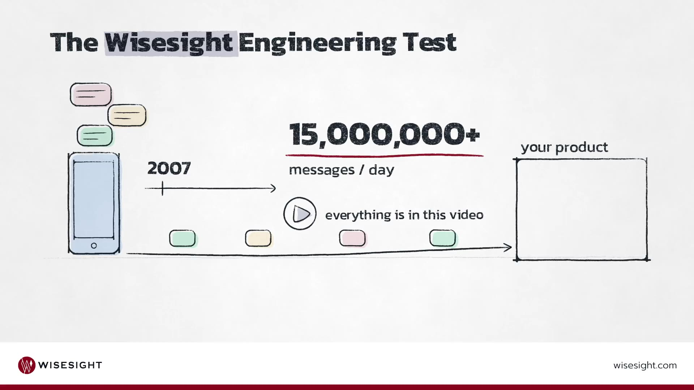

<p align="center">
  <a href="https://wisesight.com">
    <picture>
      <source media="(prefers-color-scheme: dark)" srcset="assets/wisesight-logo-horizontal-white.svg">
      
    </picture>
  </a>
</p>

<h1 align="center">Vibe Coding Test</h1>

<p align="center"><b>Software Engineer</b></p>

<p align="center"><i>Analyze Insights with Ultimate Intelligent Solution</i></p>

<p align="center">
  <a href="#english">English</a> · <a href="#ภาษาไทย">ภาษาไทย</a>
</p>

---

## English

Thank you for taking the Wisesight Vibe Coding Test for Software Engineers. Everything you need is in this repository: a video brief and an example dataset.

### 1 · Watch the brief

The full brief is in the video, and only there. Both versions have the same content; pick one and watch it to the end.

<table>
  <tr>
    <td align="center" width="50%">
      <a href="task-en.mp4"></a>
      <br><b><a href="task-en.mp4">▶ English</a></b> · 5:20
    </td>
    <td align="center" width="50%">
      <a href="task-th.mp4"></a>
      <br><b><a href="task-th.mp4">▶ Thai</a></b> · 5:50
    </td>
  </tr>
</table>

### 2 · Get the example data

| File | Size | Description |
| --- | --- | --- |
| [`resources/fabric-softener-social-messages.xlsx`](resources/fabric-softener-social-messages.xlsx) | 9.3 MB | The example dataset described in the video |

> [!NOTE]
> The example data contains real public social media posts. Use it only for this test and don't republish it.

### 3 · Submit

Send the link to your GitHub repository to the Wisesight contact who sent you this test, and make sure we can open it. Questions go to the same contact.

### Repository layout

```text
.
├── README.md
├── task-en.mp4            # the brief, English
├── task-th.mp4            # the brief, Thai
├── resources/
│   └── fabric-softener-social-messages.xlsx
└── assets/                # logo and video covers for this page
```

---

## ภาษาไทย

ขอบคุณที่มาทำแบบทดสอบ Vibe Coding สำหรับตำแหน่ง Software Engineer ของ Wisesight ทุกอย่างที่ต้องใช้อยู่ใน Repository นี้แล้ว คือวิดีโอโจทย์และชุดข้อมูลตัวอย่าง

### 1 · ดูโจทย์

โจทย์ทั้งหมดอยู่ในวิดีโอเท่านั้น ทั้งสองเวอร์ชันมีเนื้อหาเหมือนกัน เลือกภาษาที่ถนัดแล้วดูให้จบ

<table>
  <tr>
    <td align="center" width="50%">
      <a href="task-th.mp4"></a>
      <br><b><a href="task-th.mp4">▶ ภาษาไทย</a></b> · 5:50
    </td>
    <td align="center" width="50%">
      <a href="task-en.mp4"></a>
      <br><b><a href="task-en.mp4">▶ ภาษาอังกฤษ</a></b> · 5:20
    </td>
  </tr>
</table>

### 2 · ดาวน์โหลดข้อมูลตัวอย่าง

| ไฟล์ | ขนาด | รายละเอียด |
| --- | --- | --- |
| [`resources/fabric-softener-social-messages.xlsx`](resources/fabric-softener-social-messages.xlsx) | 9.3 MB | ชุดข้อมูลตัวอย่างที่พูดถึงในวิดีโอ |

> [!NOTE]
> ข้อมูลตัวอย่างเป็นโพสต์สาธารณะจริงจากโซเชียลมีเดีย ใช้สำหรับแบบทดสอบนี้เท่านั้น และห้ามนำไปเผยแพร่ต่อ

### 3 · ส่งงาน

ส่งลิงก์ GitHub Repository ของคุณให้ผู้ติดต่อจาก Wisesight ที่ส่งแบบทดสอบนี้มา และตรวจสอบว่าเราเปิดดูได้ ถ้ามีคำถามติดต่อคนเดียวกันได้เลย

### โครงสร้าง Repository

```text
.
├── README.md
├── task-en.mp4            # โจทย์ ภาษาอังกฤษ
├── task-th.mp4            # โจทย์ ภาษาไทย
├── resources/
│   └── fabric-softener-social-messages.xlsx
└── assets/                # โลโก้และภาพปกวิดีโอสำหรับหน้านี้
```

---

<p align="center">
  <sub>© 2026 Wisesight · <a href="https://wisesight.com">wisesight.com</a></sub>
</p>
